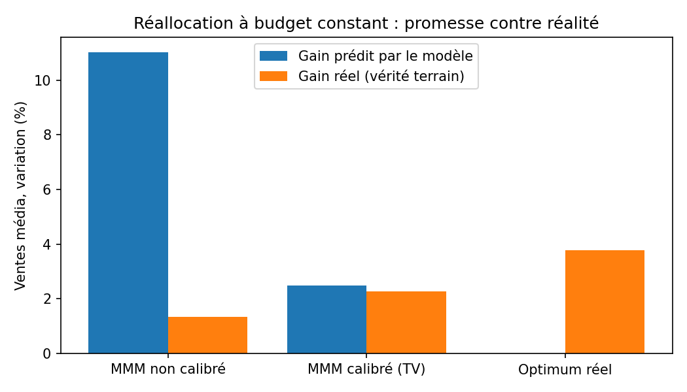
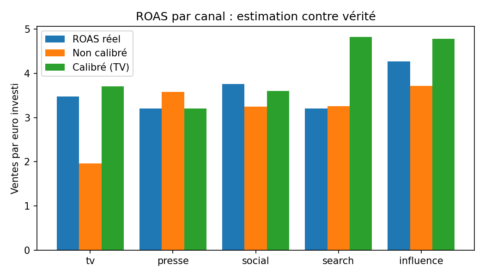
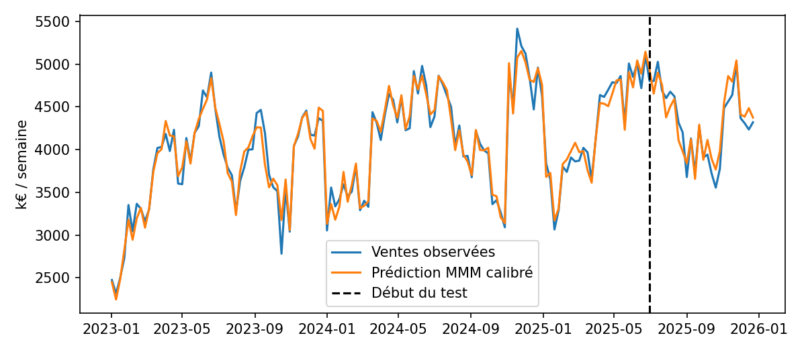

# Média & marketing : Marketing Mix Model calibré par un test d'incrémentalité

**Question métier :** quelle est la contribution réelle de chaque levier média (TV, presse,
social, search, influence) aux ventes, et comment réallouer le budget sans le dépenser davantage ?

Sur données réelles, personne ne connaît les vrais effets : impossible de savoir si un MMM a
raison. Ce projet simule donc les ventes hebdomadaires d'une **Maison de luxe fictive** sur 3 ans
(saisonnalité, pic des fêtes, effets retard et saturation des médias) avec des paramètres connus,
puis vérifie si le modèle les retrouve et si ses recommandations tiennent face à la vérité.

## Résultats clés

| | MAPE sur 26 semaines de test | Gain prédit par le modèle | Gain réel (vérité terrain) |
|---|---|---|---|
| MMM non calibré | 3,8 % | +11,0 % | +1,4 % |
| **MMM calibré par un test d'incrémentalité TV** | **3,0 %** | **+2,5 %** | **+2,3 %** |
| Optimum réel atteignable | | | +3,8 % |

*Gain = variation des ventes générées par les médias sur 52 semaines, à budget total constant,
chaque canal pouvant varier de 50 % à 150 %.*

- **Le piège** : le modèle non calibré prédit bien les ventes (MAPE 3,8 %) mais sous-estime
  fortement le ROAS de la TV (1,97 contre 3,48 en réalité). Il promet +11 % et n'apporte que
  +1,4 %. Bien prédire les ventes ne suffit pas à bien attribuer les effets.
- **La correction** : un seul test d'incrémentalité sur la TV (simulé, 5 % d'erreur de mesure)
  sert de contrainte. Le ROAS TV estimé passe à 3,71, la promesse devient réaliste (+2,5 %) et le
  gain réel monte à +2,3 %, soit **60 % du gain maximal atteignable**.
- **Recommandation** : baisser la presse et un peu la TV, renforcer le social et l'influence,
  conforme au scénario simulé où la TV est saturée et l'influence sous-investie.





## Démarrage rapide

```bash
pip install -r requirements.txt
python -m src.run_all     # environ 1 minute sur CPU
pytest -q
```

## Méthode

- **Adstock géométrique** (un investissement continue d'agir les semaines suivantes) et
  **saturation de Hill** (rendements décroissants), paramètres cherchés par recherche aléatoire.
- **Régression contrainte** : effets média positifs, tendance et saisonnalité libres
  (termes de Fourier, pic de fin d'année).
- **Sélection temporelle** : paramètres choisis sur une période de validation, évaluation finale
  sur les 26 dernières semaines jamais vues.
- **Calibration** : les jeux de paramètres dont le ROAS TV s'écarte du résultat du test
  d'incrémentalité sont pénalisés, sur le même principe que Robyn (Meta) et Meridian (Google).
- **Optimisation budgétaire** à budget constant (SLSQP), puis vérification contre le vrai
  modèle de la simulation.

## Limites

- Données simulées : le projet valide une méthode, pas des ordres de grandeur réels.
- MMM fréquentiste simplifié ; une version bayésienne (Meridian, PyMC-Marketing) donnerait des
  intervalles de crédibilité sur chaque ROAS.
